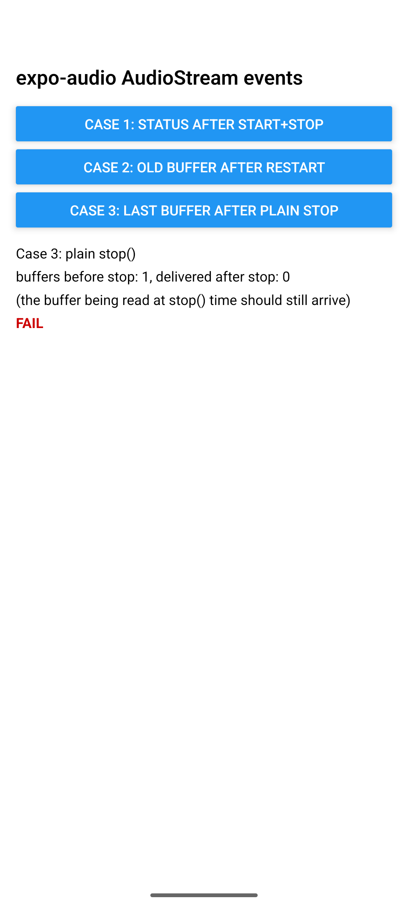

# expo-audio AudioStream: queued events report the wrong state and deliver old audio after restart

Reproduction for https://github.com/expo/expo/issues/52262 on Android, expo-audio 58.0.10, SDK 58.

On Android, `AudioStream` posts its `audioStreamStatus` and `audioStreamBuffer` events to the main
queue and reads `isStreaming` when the event runs, not when it was queued. A PCM buffer that was
queued before `stop()` is still delivered after the next `start()`.

## Run

```sh
npm install
npx expo run:android      # development build, Android emulator or device
```

Grant the microphone permission when asked, then tap a button.

## Cases

**Case 1: status after start() and stop().** Await `stream.start()`, call `stream.stop()` right
away, collect the `audioStreamStatus` events for one second. Expected `[true, false]`.

**Case 2: old buffer after restart.** Await `start()`, record for 1.2 s, then call `stop()` and
`await start()` back to back and watch for 0.6 s. A buffer from the stopped session carries a
native `timestamp` of about 1.2 s; a buffer from the new session in that window stays under 0.9 s.
Expected: no buffer with a timestamp over 0.9 s after the restart.

**Case 3: last buffer after a plain stop().** Await `start()`, wait for a buffer, call `stop()`,
count the buffers that arrive in the next 0.5 s. Shows what happens to the chunk that was being
read when `stop()` was called.

## Results (Android 17 emulator, API 37, expo-audio 58.0.10, SDK 58)

| | Before the fix | With the fix (PR 52275) |
| --- | --- | --- |
| Case 1, 5 runs | `[true, false]` every run | `[true, false]` every run |
| Case 2, 10 runs | an old buffer after every restart | 1 run of 10 |
| Case 3, 5 runs | 1 buffer delivered after every `stop()` | 0 |

| Case 2, before | Case 2, with the fix | Case 3, with the fix |
| --- | --- | --- |
|  |  |  |

Notes on the numbers:

- Case 1 does not reproduce from JavaScript. `stream.start()` is an async native function, so by the
  time `stop()` runs the queued `true` event has already been read. The issue's `[false, false]`
  comes from calling the native `start()` and `stop()` back to back on one thread, which the
  reporter's JVM harness does. The fix captures the value when the event is queued, which closes
  that path.
- The one remaining Case 2 delivery with the fix was a buffer that had already been emitted to
  JavaScript before `stop()` ran; it reached the JavaScript thread 1 ms after `stop()` returned.
  No native check can retract an event that was already handed over.
- Case 3 shows the trade-off the fix makes: the chunk being read when `stop()` is called is
  discarded, which is what the issue asks for. Keeping it would also deliver it after an immediate
  restart, because at the time it is queued nobody knows whether a restart follows.

## Testing a patched expo-audio

Android links `expo-audio` as a published artifact. To build it from the sources in
`node_modules` instead, add this to `package.json` before `npx expo run:android`:

```json
"expo": { "autolinking": { "buildFromSource": ["expo-audio"] } }
```

## Where it is in the source

`packages/expo-audio/android/src/main/java/expo/modules/audio/AudioStream.kt`:

```kotlin
private fun emitStatus() {
  appContext?.mainQueue?.launch {
    emit(AUDIO_STREAM_STATUS, mapOf("isStreaming" to isStreaming))  // read when the block runs
  }
}
```

`emitBufferEvent` posts the buffer the same way and never checks whether the session that produced
it is still running.

## Notes

- Fix: https://github.com/expo/expo/pull/52275

- The emulator's microphone delivers silence, which is enough: only the event order and state
  matter here.
- The Gradle wrapper in a fresh prebuild points at Gradle 9.4.1. If that download fails on your
  network, download the zip once and point `distributionUrl` at the local file.

