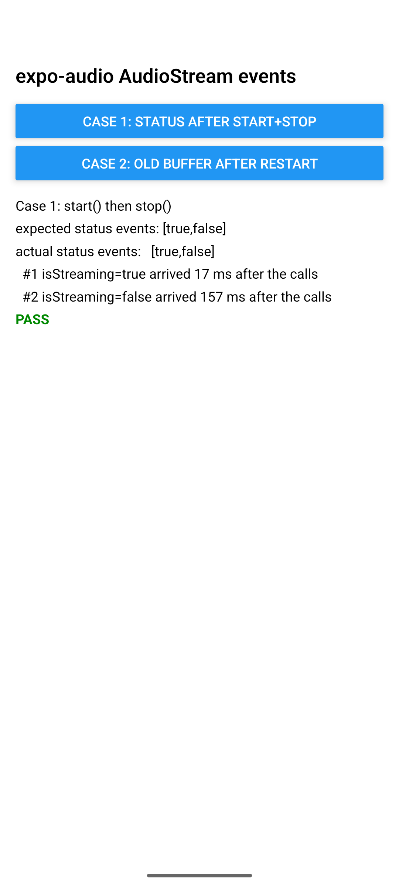
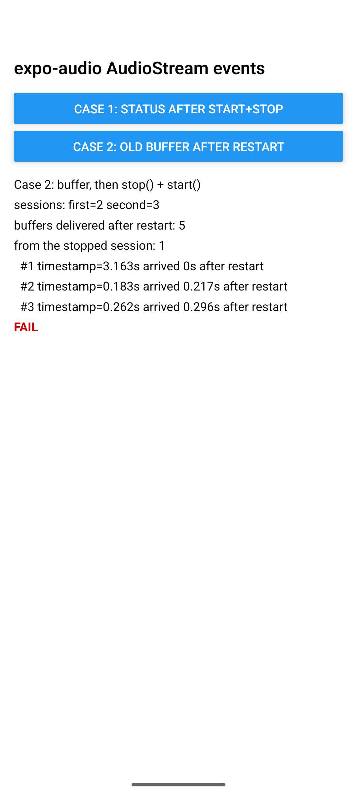

# expo-audio AudioStream: queued events report the wrong state and deliver old audio after restart

Reproduction for https://github.com/expo/expo/issues/52262 on Android, expo-audio 58.0.10, SDK 58.

On Android, `AudioStream` posts its `audioStreamStatus` and `audioStreamBuffer` events to the main
queue and reads `isStreaming` when the event runs, not when it was queued. A PCM buffer that was
queued before `stop()` is still delivered after the next `start()`.

## Run

```sh
npm install
npx expo run:android      # development build, Android emulator or device
```

Grant the microphone permission when asked, then tap a button.

## Cases

**Case 1: status after start() and stop().** The app calls `stream.start()` and `stream.stop()`
back to back and collects the `audioStreamStatus` events for half a second.

- Expected: `[true, false]`
- Actual: `[false, false]`. Both events run after `stop()` and read the final state.

**Case 2: old buffer after restart.** The app starts the stream, waits for one PCM buffer, then
calls `stop()` and `start()` back to back. It records every buffer delivered after the restart with
the buffer's `timestamp`, which the native side measures from the start of its own session.

- Expected: no buffer from the stopped session is delivered after the restart.
- Actual: the first buffer delivered after `start()` carries a timestamp from the stopped session,
  larger than the time elapsed since the restart.

## Where it is in the source

`packages/expo-audio/android/src/main/java/expo/modules/audio/AudioStream.kt`:

```kotlin
private fun emitStatus() {
  appContext?.mainQueue?.launch {
    emit(AUDIO_STREAM_STATUS, mapOf("isStreaming" to isStreaming))  // read when the block runs
  }
}
```

`emitBufferEvent` posts the buffer the same way and never checks whether the session that produced
it is still running.

## Results (Android 17 emulator, API 37, expo-audio 58.0.10, SDK 58)

**Case 1**, five runs of `start()` then `stop()`. Expected `[true, false]` every time. Observed:

| Run | Status events |
| --- | --- |
| 1 | `[true]` |
| 2 | `[false]` |
| 3 | `[true]` |
| 4 | `[false, true]` |
| 5 | `[true]` |

The value depends on when the queued block runs relative to `stop()`, and one of the two events is
often missing.

**Case 2**, one run. Five buffers were delivered after the restart. The first one arrived 0 s after
`start()` with a timestamp of 3.163 s, measured from the start of the stopped session. The next
ones carry timestamps that match the new session.

| Case 1 | Case 2 |
| --- | --- |
|  |  |

## Notes

- The emulator's microphone delivers silence, which is enough: only the event order and state
  matter here.
- The Gradle wrapper in a fresh prebuild points at Gradle 9.4.1. If that download fails on your
  network, download the zip once and point `distributionUrl` at the local file.

