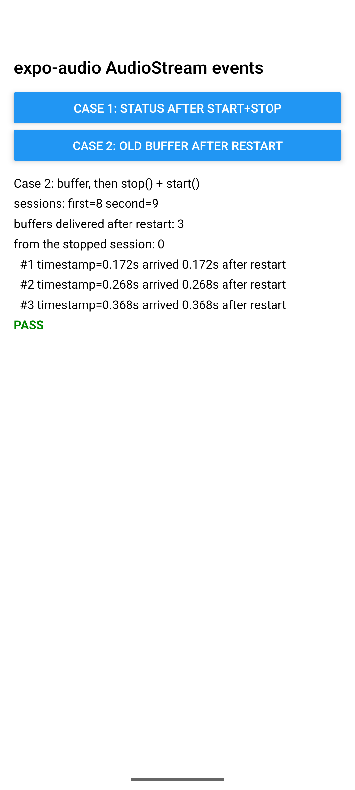

# expo-audio AudioStream: queued events report the wrong state and deliver old audio after restart

Reproduction for https://github.com/expo/expo/issues/52262 on Android, expo-audio 58.0.10, SDK 58.

On Android, `AudioStream` posts its `audioStreamStatus` and `audioStreamBuffer` events to the main
queue and reads `isStreaming` when the event runs, not when it was queued. A PCM buffer that was
queued before `stop()` is still delivered after the next `start()`.

## Run

```sh
npm install
npx expo run:android      # development build, Android emulator or device
```

Grant the microphone permission when asked, then tap a button.

## Cases

**Case 1: status after start() and stop().** The app awaits `stream.start()`, calls
`stream.stop()` right away, and collects the `audioStreamStatus` events for one second.
Expected `[true, false]`.

**Case 2: old buffer after restart.** The app starts the stream, waits for one PCM buffer, then
calls `stop()` and `start()` back to back. Every buffer delivered after the restart is recorded with
its `timestamp`, which the native side measures from the start of its own session, and with the
time it arrived relative to the restart. A buffer whose timestamp is larger than the time since the
restart was recorded by the stopped session. Expected: none.

## Results (Android 17 emulator, API 37, expo-audio 58.0.10, SDK 58)

| | Before the fix | After the fix |
| --- | --- | --- |
| Case 1, 5 runs | `[true, false]` every run | `[true, false]` every run |
| Case 2, 2 runs | 1 old buffer delivered after each restart, for example timestamp 0.249 s arriving 0.045 s before `start()` resolved | 0 old buffers; first buffer 0.233 s / 0.172 s, matching the new session |

| Case 1, before | Case 2, before | Case 2, after |
| --- | --- | --- |
|  |  |  |

Case 1 does not reproduce from JavaScript. `stream.start()` is an async native function, so by the
time `stop()` runs the queued `true` event has already been read. The issue's `[false, false]`
comes from calling the native `start()` and `stop()` back to back on the same thread, which the
reporter's JVM harness does. The fix still captures the value when the event is queued, so the
report cannot read a later state.

Case 2 reproduces on every run and is fixed by dropping queued buffers whose session has stopped.

## Testing a patched expo-audio

Android links `expo-audio` as a published artifact. To build it from the sources in
`node_modules` instead, add this to `package.json` before `npx expo run:android`:

```json
"expo": { "autolinking": { "buildFromSource": ["expo-audio"] } }
```

## Where it is in the source

`packages/expo-audio/android/src/main/java/expo/modules/audio/AudioStream.kt`:

```kotlin
private fun emitStatus() {
  appContext?.mainQueue?.launch {
    emit(AUDIO_STREAM_STATUS, mapOf("isStreaming" to isStreaming))  // read when the block runs
  }
}
```

`emitBufferEvent` posts the buffer the same way and never checks whether the session that produced
it is still running.

## Notes

- Fix: https://github.com/expo/expo/pull/52275

- The emulator's microphone delivers silence, which is enough: only the event order and state
  matter here.
- The Gradle wrapper in a fresh prebuild points at Gradle 9.4.1. If that download fails on your
  network, download the zip once and point `distributionUrl` at the local file.

